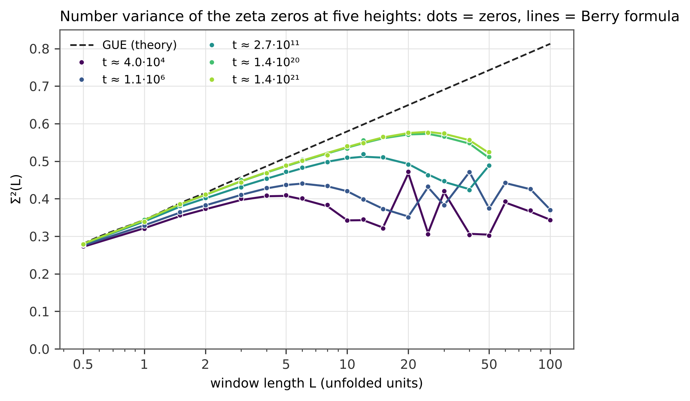
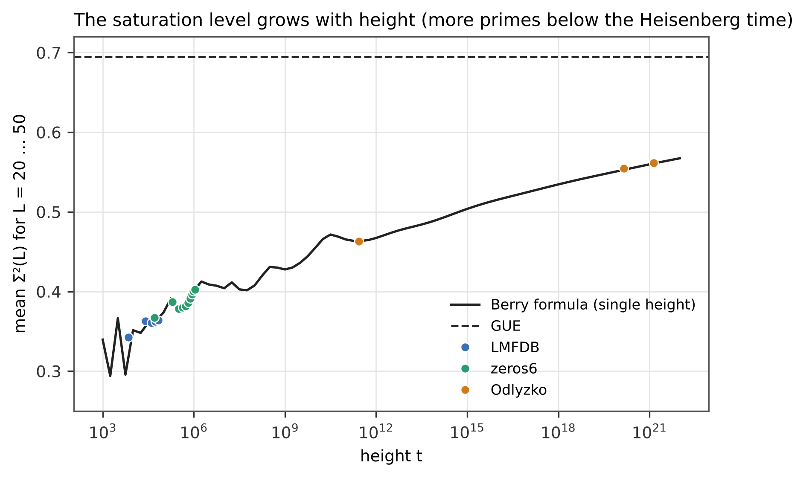
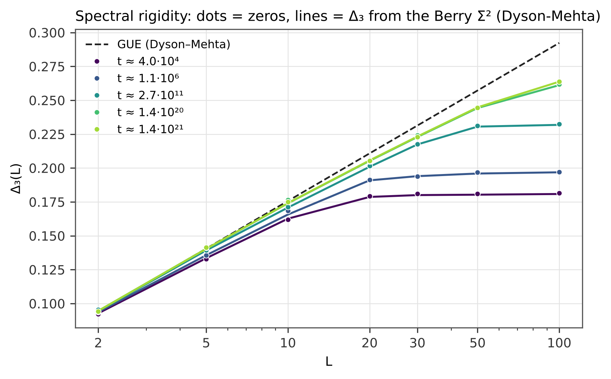
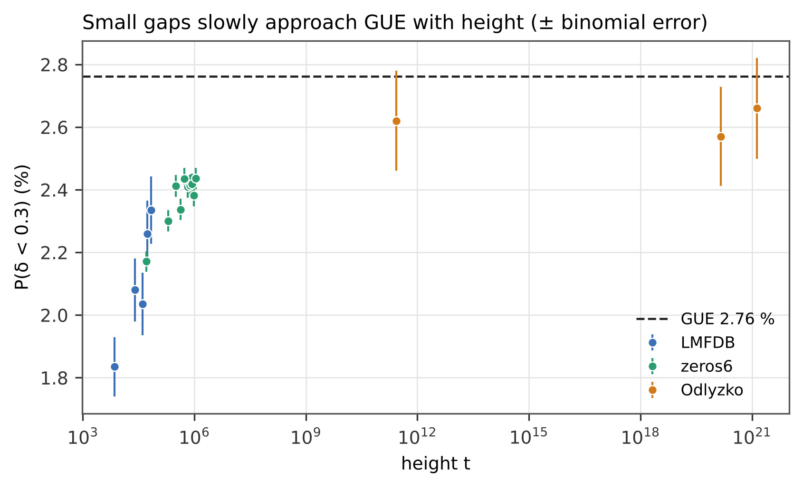
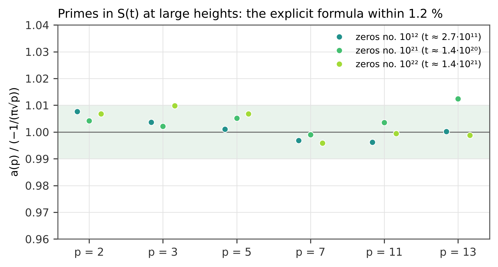
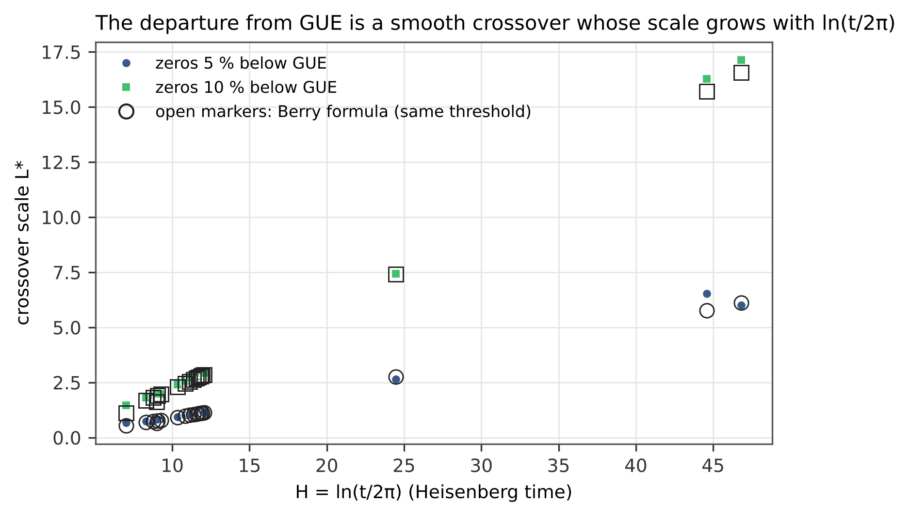

# 1. Introduction

Montgomery [1] conjectured that the pair correlation of the zeros of $\zeta(s)$ coincides with that of the eigenvalues of large random matrices from the Gaussian Unitary Ensemble (GUE); he proved it, assuming the Riemann hypothesis, for test functions whose Fourier transform is supported in $(-1, 1)$. Odlyzko [4] confirmed the agreement numerically near the zero number $10^{12}$. GUE, however, describes only short distances. On long distances the zeros "remember" the primes: Berry [2, 3] showed semiclassically that the number variance $\Sigma^2(L)$ saturates instead of growing logarithmically, and gave an explicit formula for it in terms of prime powers $p^k$ — the analogue of the periodic orbits of a chaotic system.

This note reports a systematic test of Berry's formula on 18 blocks of zeros at heights from $10^4$ to $10^{21}$, together with null models (GUE, random primes), the spectral rigidity $\Delta_3$, small gaps, the prime content of $S(t)$, and a sieve for candidate spectra. All numbers are produced by the scripts that accompany this article and are cross-checked by an independent implementation; every file is identified by its SHA-256 hash (Section 6).

# 2. Data

| block | zeros | height $t$ | source |
|---|---|---|---|
| LMFDB 1–5 | $5 \times 20\,000$ | 14 … 74 921 | LMFDB [11] |
| zeros6 1–10 | $10 \times 200\,000$ | 14 … $1.13 \cdot 10^6$ | Odlyzko's table of the first 2,001,052 zeros [13] |
| Odlyzko $10^{12}$ | 10 000 | $\approx 2.68 \cdot 10^{11}$ | zeros no. $10^{12}+1 \dots$ [13] |
| Odlyzko $10^{21}$ | 10 000 | $\approx 1.44 \cdot 10^{20}$ | zeros no. $10^{21}+1 \dots$ [13] |
| Odlyzko $10^{22}$ | 10 000 | $\approx 1.37 \cdot 10^{21}$ | zeros no. $10^{22}+1 \dots$ [13] |

The zeros are unfolded by the smooth counting function $x_n = N_s(t_n)$, $N_s(t) = \frac{t}{2\pi}\left(\ln\frac{t}{2\pi} - 1\right) + \frac{7}{8}$. Odlyzko's high tables give offsets $\delta_n = t_n - B$ from a large integer base $B$; there we unfold locally, $x_n = \delta_n H/(2\pi) + \delta_n^2/(4\pi B)$ with $H = \ln(B/2\pi)$.

# 3. Methods

**Number variance.** $\Sigma^2(L) = \langle (N(x, x+L) - \langle N \rangle)^2 \rangle$ in unfolded units, averaged over the window position $x$; window starts are spaced by 0.37 (an irrational-like step that samples all offsets; a fixed offset biases $\Sigma^2$, e.g. $\Sigma^2(10)$ ranges from 0.18 to 0.46 with the offset).

**Spectral rigidity.** $\Delta_3(L) = \langle \min_{a,b} \frac{1}{L}\int_x^{x+L}[N(y) - a y - b]^2\,dy \rangle$, computed exactly (normal equations for the staircase) on 800 uniformly spaced windows.

**Berry's formula** [3]. With $H = \ln(t/2\pi)$ (the Heisenberg time),
$$\Sigma^2_B(L; t) = \frac{1}{\pi^2}\sum_{p^k \le t/2\pi} \frac{1 - \cos(2\pi L\, k \ln p / H)}{k^2 p^k} + \frac{1 - \cos 2\pi L}{\pi^2} + L\left[1 - \frac{2}{\pi}\,\mathrm{Si}(2\pi L)\right].$$
Prime orbits shorter than the Heisenberg time enter individually; longer ones are replaced by their GUE (diagonal) average. Primes up to $10^6$ are summed explicitly; above $10^6$ the prime number theorem gives $\int_{u_0}^{H} (1 - \cos(2\pi L u/H))\,du/u$. For a block, the formula is averaged over 48 heights spread uniformly in index (one height for the Odlyzko blocks). No parameter is fitted.

**Null models.** (i) GUE: $\Sigma^2_{GUE}(L) = \frac{1}{\pi^2}[\ln 2\pi L + \gamma + 1 - \cos 2\pi L - \mathrm{Ci}(2\pi L)] + L[1 - \frac{2}{\pi}\mathrm{Si}(2\pi L)]$ [5, 6]. (ii) Cramér: Berry's formula with random "primes", each $n \le 10^6$ chosen with probability $1/\ln n$ (fixed seed), i.e. the same density but different positions.

**$\Delta_3$ from $\Sigma^2$.** $\Delta_3(L) = \frac{2}{L^4}\int_0^L (L^3 - 2L^2 r + r^3)\,\Sigma^2(r)\,dr$ [5]. For each prime term the integral is exact, $\frac{2}{L^4}\int_0^L (L^3 - 2L^2 r + r^3)(1 - \cos br)\,dr = 2A(bL)$ with $A(x) = \frac14 - \frac{\cos x + 2}{x^2} + \frac{6\sin x}{x^3} - \frac{6(1-\cos x)}{x^4}$; the smooth part is integrated numerically.

**Prime content of $S(t)$.** With $S_n = n - \frac12 - N_s(t_n)$, the projection $a(p) = \frac{2}{N}\sum_n (S_n - \bar S)\sin(t_n \ln p)$ is compared with the explicit-formula amplitude $-1/(\pi\sqrt p)$. At the Odlyzko heights the phase $B \ln p \bmod 2\pi$ is computed to 60 digits.

**Sieve for candidate spectra.** A candidate spectrum of 20,000 levels must pass (1) density and rigidity: $|\bar S| < 0.25$, $\sigma_S < 1.5$; (2) gaps: nearest class GUE and Kolmogorov–Smirnov distance $\le 0.05 + 1.36/\sqrt N$; (3) primes: $a(p)/(-1/\pi\sqrt p) \in (0.85, 1.15)$ for $p = 2, 3, 5, 7$; (4) saturation: $\Sigma^2(30) - \Sigma^2(10)$ below half of the GUE growth (0.056).

# 4. Results

## 4.1 Berry's formula against the zeros

| block | $t \approx$ | $\Sigma^2(10)$ zeros / Berry | $\Sigma^2(30)$ zeros / Berry / GUE | RMS Berry | RMS Cramér | RMS GUE | saturation level |
|---|---|---|---|---|---|---|---|
| LMFDB 40 001–60 000 | $4.0\cdot10^4$ | 0.343 / 0.342 | 0.420 / 0.417 / 0.691 | 0.71 % | 7.4 % | 79 % | 0.361 |
| zeros6 1.8–2.0 M | $1.1\cdot10^6$ | 0.421 / 0.420 | 0.383 / 0.383 / 0.691 | 0.26 % | 8.3 % | 57 % | 0.403 |
| Odlyzko $10^{12}$ | $2.7\cdot10^{11}$ | 0.510 / 0.508 | 0.448 / 0.445 / 0.691 | 0.56 % | 6.1 % | 30 % | 0.463 |
| Odlyzko $10^{21}$ | $1.4\cdot10^{20}$ | 0.534 / 0.536 | 0.566 / 0.565 / 0.691 | 0.60 % | 5.4 % | 16 % | 0.554 |
| Odlyzko $10^{22}$ | $1.4\cdot10^{21}$ | 0.540 / 0.538 | 0.574 / 0.573 / 0.691 | 0.54 % | 5.6 % | 15 % | 0.562 |

RMS = root-mean-square relative deviation over $L = 0.5 \dots 100$ (Odlyzko: $0.5 \dots 50$); saturation level = mean $\Sigma^2$ over $L = 20 \dots 50$.

Over all 18 blocks the RMS deviation of Berry's formula is 0.26–1.21 % (largest for the lowest blocks), including the oscillations of $\Sigma^2(L)$ with period $\approx H/\ln 2$ in $L$ caused by the prime 2 (Figure 1). On the whole zeros6 set, with windows up to $L = 1000$ (about 2,000 independent windows), $\Sigma^2(200/300/500/1000) = 0.393/0.395/0.385/0.387$ against Berry $0.391/0.391/0.387/0.389$ and GUE $0.88/0.92/0.98/1.05$.

{width=92%}

## 4.2 The exact position of the primes matters

Berry's formula with Cramér's random primes — same density $1/\ln n$, different positions — deviates by 5.4–9.9 % in all blocks above the lowest ones, i.e. ten to twenty times more than with the true primes (Figure 2). The oscillations of $\Sigma^2(L)$ are carried by the exact positions of the small primes 2, 3, 5, …

{width=92%}

## 4.3 The saturation level grows with height

The level of saturation grows from 0.34 ($t \approx 10^4$) through 0.40 ($10^6$) and 0.46 ($3\cdot10^{11}$) to 0.55–0.56 ($10^{20}$–$10^{21}$), along Berry's curve and below GUE (0.69) (Figure 3). Unfolding removes the mean density but not the number of primes below the Heisenberg time, $\sum_{p^k < t/2\pi} 1/(k^2 p^k) \sim \ln\ln t$. Hence the statement "$\Sigma^2$ in unfolded units does not depend on the height" holds for GUE but not for the zeros of $\zeta$.

{width=92%}

## 4.4 Spectral rigidity

$\Delta_3$ measured on 800 windows and $\Delta_3$ computed from Berry's $\Sigma^2$ agree within 3.3 % (mean 1.5 %; the scatter is statistical) (Figure 4). At short windows the zeros coincide with GUE ($\Delta_3(2) = 0.094$ for both); at long windows they saturate below GUE: $\Delta_3(100) = 0.17$ ($t \approx 10^4$) to $0.26$ ($t \approx 10^{21}$) against GUE 0.29 and the crystal value $1/12 \approx 0.083$.

{width=92%}

## 4.5 Small gaps

The share of unfolded gaps below 0.3 grows from 1.8 % (first 20,000 zeros) through 2.2 % ($10^5$) and 2.4 % ($10^6$) to 2.6 % ($3\cdot10^{11}$ to $10^{21}$), against the GUE value 2.76 % (Figure 5). The approach is logarithmically slow, as predicted by the finite-height corrections of Bogomolny et al. [12].

{width=92%}

## 4.6 Primes in $S(t)$ at large heights

At the zeros no. $10^{22}+1 \dots 10^{22}+10^4$ ($t \approx 1.4\cdot10^{21}$) the ratio $a(p)/(-1/\pi\sqrt p)$ equals 1.007, 1.010, 1.007, 0.996, 0.999, 0.999 for $p = 2 \dots 13$ (Figure 6); near $10^{12}$ and $10^{21}$ also within 1.2 %. The decline of the ratio with $p$ seen at low heights (up to 12 % for the first $10^4$ zeros) is an effect of sampling $S(t)$ at the zeros and disappears with height.

{width=92%}

## 4.7 The crossover scale

Defining the departure from GUE as the smallest $L^*$ at which the zeros lie 5 % (10 %) below GUE gives $L^* \approx 0.09$–$0.15\,H$ ($0.21$–$0.37\,H$), from $L^* = 0.67$ at $H = 7$ to $L^* = 6.0$ at $H = 46.8$, equal to the value from Berry's formula (Figure 7). The transition is a smooth crossover whose scale grows with the Heisenberg time $\ln(t/2\pi)$, not a sharp threshold; the threshold itself (5 % or 10 %) changes $L^*$ by a factor of about three.

{width=92%}

## 4.8 Sieve for candidate spectra

| candidate (20,000 levels) | density | GUE gaps | primes | saturation |
|---|---|---|---|---|
| true zeros | pass | pass | pass | pass |
| levels $xp$ (Berry–Keating) | pass | fail | fail | pass |
| $xp$ + prime orbits $p^k \le 997$ | pass | pass | pass | pass |
| GUE matrix | pass | pass | fail | fail |
| GOE matrix | pass | fail | fail | fail |
| Poisson | fail | fail | fail | fail |
| zeros + noise $\sigma = 0.3$ | pass | fail | fail | pass |

A GUE random matrix reproduces the local statistics but has no prime content and no saturation. The levels of $xp$ completed by the prime orbits of the explicit formula pass all four stages — a construction that shows what an operator would have to contain, not an operator. The zeros of twelve Dirichlet $L$-functions $L(s, \chi_q)$, $q = 3 \dots 41$, pass with the weights $\chi(p)$, and the sign of $a(p)$ equals $\chi(p)$ in 67 of 67 pairs: the signal is the arithmetic of the particular function.

# 5. Discussion

Berry's formula is the diagonal approximation of the explicit (trace) formula; its success over 17 orders of magnitude in height, without a free parameter, confirms that the long-range statistics of the zeros are fixed by the primes. The residual of about 1 % in the lowest blocks is consistent with the expected size of the off-diagonal (Hardy–Littlewood) corrections computed by Bogomolny and Keating [8] together with finite-sample noise; separating the two is the subject of follow-up work. The saturation and the other statistics follow from the arithmetic of the primes, not from the position of the zeros: they neither confirm nor refute the Riemann hypothesis, and no self-adjoint operator with this spectrum is known (Hilbert–Pólya remains open). Berry compared his formula with Odlyzko's zeros near $10^{12}$ in 1988; the present study repeats that comparison and extends it to $10^{21}$, $10^{22}$ and two million low zeros with independent checks.

# 6. Reproducibility

The script `compute_rigidity.py` recomputes every number of Sections 4.1–4.7 from the original text files of zeros (LMFDB, Odlyzko), and `figures.py` draws every figure from its output. The script `independent_check.py` recomputes the same quantities with partly different algorithms (primes by a segmented sieve, the prime tail above $10^6$ and $\Delta_3$ from Berry's $\Sigma^2$ by quadrature) and agrees within $10^{-11}$. The results of the sieve (Section 4.8) are given as data. The computations were developed and verified in the protected MAYAN ALFA V1008 laboratory (internal, version 34.47; mayanalfa.com), which is not part of this package. The package lists the SHA-256 hash of every file. Text, figures and data are released under the Creative Commons Attribution 4.0 International licence (CC BY 4.0); the scripts under the MIT licence.

# References

1. Montgomery, H. L. (1973). The pair correlation of zeros of the zeta function. Proc. Symp. Pure Math. 24, 181–193.
2. Berry, M. V. (1985). Semiclassical theory of spectral rigidity. Proc. R. Soc. A 400, 229–251.
3. Berry, M. V. (1988). Semiclassical formula for the number variance of the Riemann zeros. Nonlinearity 1, 399–407.
4. Odlyzko, A. M. (1987). On the distribution of spacings between zeros of the zeta function. Math. Comp. 48, 273–308.
5. Dyson, F. J. & Mehta, M. L. (1963). Statistical theory of the energy levels of complex systems. IV. J. Math. Phys. 4, 701–712.
6. Mehta, M. L. (2004). Random Matrices, 3rd ed. Academic Press.
7. Berry, M. V. & Keating, J. P. (1999). The Riemann zeros and eigenvalue asymptotics. SIAM Rev. 41, 236–266.
8. Bogomolny, E. B. & Keating, J. P. (1996). Gutzwiller's trace formula and spectral statistics: beyond the diagonal approximation. Phys. Rev. Lett. 77, 1472–1475.
9. Gonek, S. M., Hughes, C. P. & Keating, J. P. (2007). A hybrid Euler–Hadamard product for the Riemann zeta function. Duke Math. J. 136, 507–549.
10. Dumitriu, I. & Edelman, A. (2002). Matrix models for beta ensembles. J. Math. Phys. 43, 5830–5847.
11. The LMFDB Collaboration. The L-functions and Modular Forms Database. https://www.lmfdb.org/
12. Bogomolny, E., Bohigas, O., Leboeuf, P. & Monastra, A. G. (2006). On the spacing distribution of the Riemann zeros: corrections to the asymptotic result. J. Phys. A 39, 10743–10754.
13. Odlyzko, A. M. Tables of zeros of the Riemann zeta function. https://www-users.cse.umn.edu/~odlyzko/zeta_tables/
